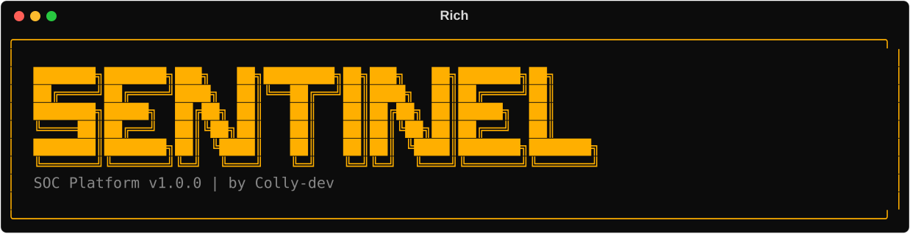

# SentinelSOC 🛡️

[](https://github.com/Colly-dev/SentinelSOC/actions/workflows/ci.yml)
[](https://opensource.org/licenses/MIT)
[](https://www.python.org/downloads/release/python-3120/)

**SentinelSOC** is a production-grade, Python-powered Security Operations Center (SOC) simulation platform designed to demonstrate real-world blue team, detection engineering, threat hunting, and security monitoring capabilities.

## 📸 Screenshots

> **Note**: These screenshots are available in the `docs/screenshots/` directory.

### Terminal Banner


### Detection Output

*Example of the tool detecting a Brute Force attack in real-time.*

### Incident Report

*Professional HTML report generated by the Reporting Engine.*

### Dashboard Integration

*Visualizing alerts using the provided Kibana configuration.*

## 🚀 Overview

SentinelSOC provides a complete pipeline for security monitoring:
- **Log Collection**: Ingests Windows Event Logs, Sysmon, Linux Syslog, and Authentication logs.
- **Normalization**: Standardizes diverse log formats into a common schema.
- **Detection Engineering**: Implements detection logic for Brute Force, PowerShell Abuse, Malware Behavior, and more.
- **Incident Response**: Correlates related alerts into incidents for streamlined investigation.
- **Reporting**: Generates professional HTML, JSON, and CSV reports.

## 🏗️ Architecture

SentinelSOC orchestrates a complete **9-step SOC Pipeline**:
1. **Collect**: Ingest raw logs.
2. **Normalize**: Convert to Common Schema.
3. **Validate**: Ensure data integrity.
4. **Detect**: Apply detection logic.
5. **Alert**: Generate security alerts.
6. **Correlate**: Group related alerts.
7. **Incident**: Create incident cases.
8. **Report**: Generate HTML/JSON/CSV reports.
9. **Visualize**: Feed data to dashboards.

### Architecture Diagram


## 🛠️ Installation

### Prerequisites
- **Python 3.12+**
- **Docker & Docker Compose** (Required for Elasticsearch, Kibana, and Wazuh integrations)
- **Git**

### Setup & OS-Specific Instructions

#### 1. Clone the Repository
```bash
git clone https://github.com/Colly-dev/SentinelSOC.git
cd SentinelSOC
```

#### 2. Create and Activate Virtual Environment

| Operating System | Command |
|------------------|---------|
| **Windows (CMD)** | `python -m venv venv` <br> `venv\Scripts\activate` |
| **Windows (PowerShell)** | `python -m venv venv` <br> `.\venv\Scripts\Activate.ps1` |
| **Linux / macOS** | `python3 -m venv venv` <br> `source venv/bin/activate` |

#### 3. Install Dependencies
Regardless of your OS, once the virtual environment is activated, run:
```bash
pip install -r requirements.txt
```

> **Note for Linux Users**: You might need to install `python3-venv` first if it's not present: `sudo apt install python3-venv`.

#### 4. (Optional) Start Dashboard Services
If you have Docker installed and want to use the integrated dashboards:
```bash
docker-compose -f docker/docker-compose.yml up -d
```

## 📖 Usage

SentinelSOC provides a comprehensive CLI:

- **Full SOC Workflow**:
  ```bash
  python main.py full
  ```
- **Run Attack Simulations**:
  ```bash
  python main.py simulate --attack brute_force
  ```
- **Collect and Detect**:
  ```bash
  python main.py collect
  python main.py detect
  ```
- **Generate Reports**:
  ```bash
  python main.py report --type html
  ```

## 🛡️ MITRE ATT&CK® Mapping

| Technique ID | Technique Name | SentinelSOC Detection |
|--------------|----------------|-----------------------|
| T1110        | Brute Force    | BruteForceDetector    |
| T1059.001    | PowerShell     | PowerShellAbuseDetector|
| T1204.002    | User Execution | MalwareBehaviorDetector|
| T1078        | Valid Accounts | SuspiciousLoginDetector|
| T1547.001    | Registry Run Keys| PersistenceDetector  |
| T1021.002    | Remote Services| LateralMovementDetector|

## 📊 Dashboard Integrations
Configurations and sample dashboards are provided for:
- **Elasticsearch/Kibana**
- **Wazuh**
- **Splunk**

See `src/dashboards/` for more details.

## 📄 License
This project is licensed under the MIT License - see the [LICENSE](LICENSE) file for details.

## 👤 Author
Created by **Colly-dev** for cybersecurity portfolio and educational purposes.
